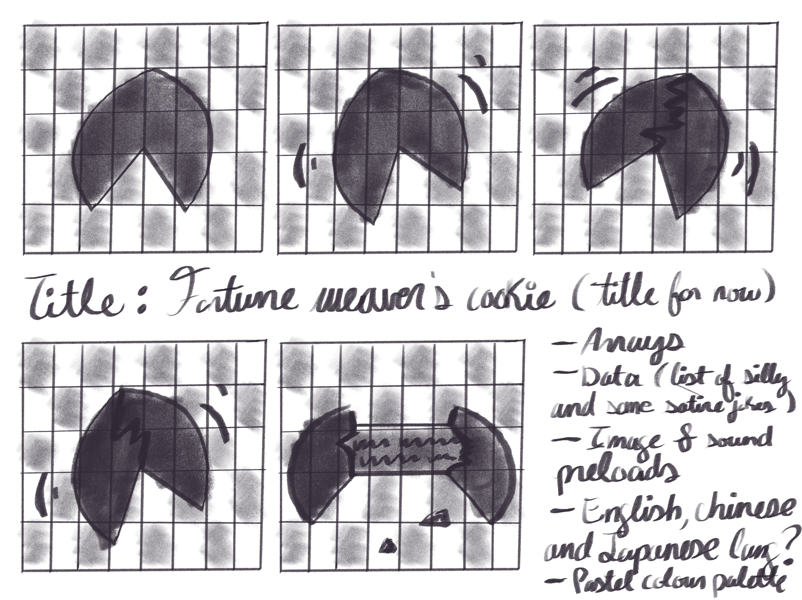
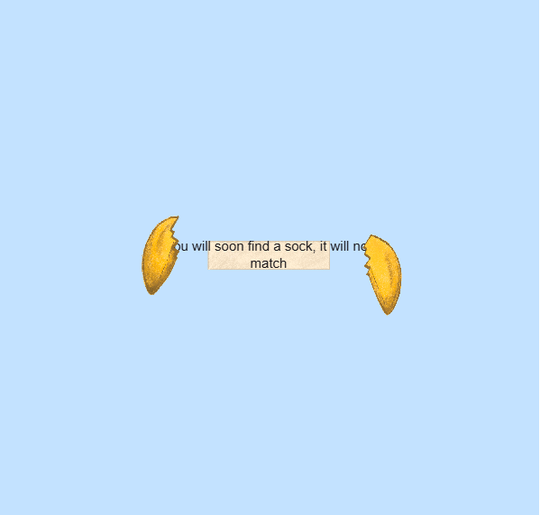
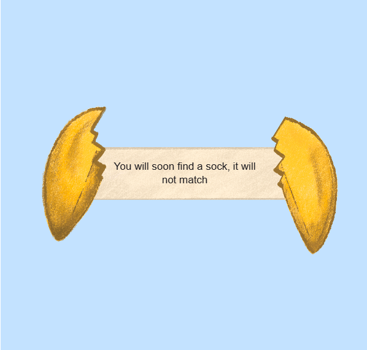

[Home 🏠](README.md) / [Portfolio 💼](https://sabrinarath263.wixsite.com/srathdesigns) /  [Challenges](Challenges.md) / [Prototypes 💻](Prototypes.md)

# Final Project

## [Reflective Journal](Journal.md)

 # **Fortune Weaver's Cookie**

SABRINA RATH

[View this project online]() COMING SOON

[View the code to this project](https://github.com/Sabiewasabi/CART253/blob/main/topics/final-project/js/fortune-weavers-cookie.js)

## Description

> This project simulats receiving the special message inside a fortune cookie.Instead of the secret message containing the standard generic and boring messages, these cookie will be sure to contain something that will definetely make you smile.

> The experience is controlled via mouse clicks on the fortune cookie to crack it open and receive your special message. Click it again and receive another fortune.

> Would you like another cookie? Well then, another fortune awaits you.

## Screenshot(s)

COMING SOON

## Attribution

> - This project uses [p5.js](https://p5js.org).
> - The image is a capture of *Fortune Weaver's Cookie* live on p5.js.

## License

> This project is licensed under a Creative Commons Attribution ([CC BY 4.0](https://creativecommons.org/licenses/by/4.0/deed.en)) license with the exception of libraries and other components with their own licenses.

## **Journey of my project**

## <mark>PART 1: Ideation sketch </mark>  - **11/14/2026**

## <mark> PART 2: Early stage of project </mark>  - **11/19/2026**

>It works...sort of but it's so ugly...BUT BUT it works technically!

> Fixed it!!

