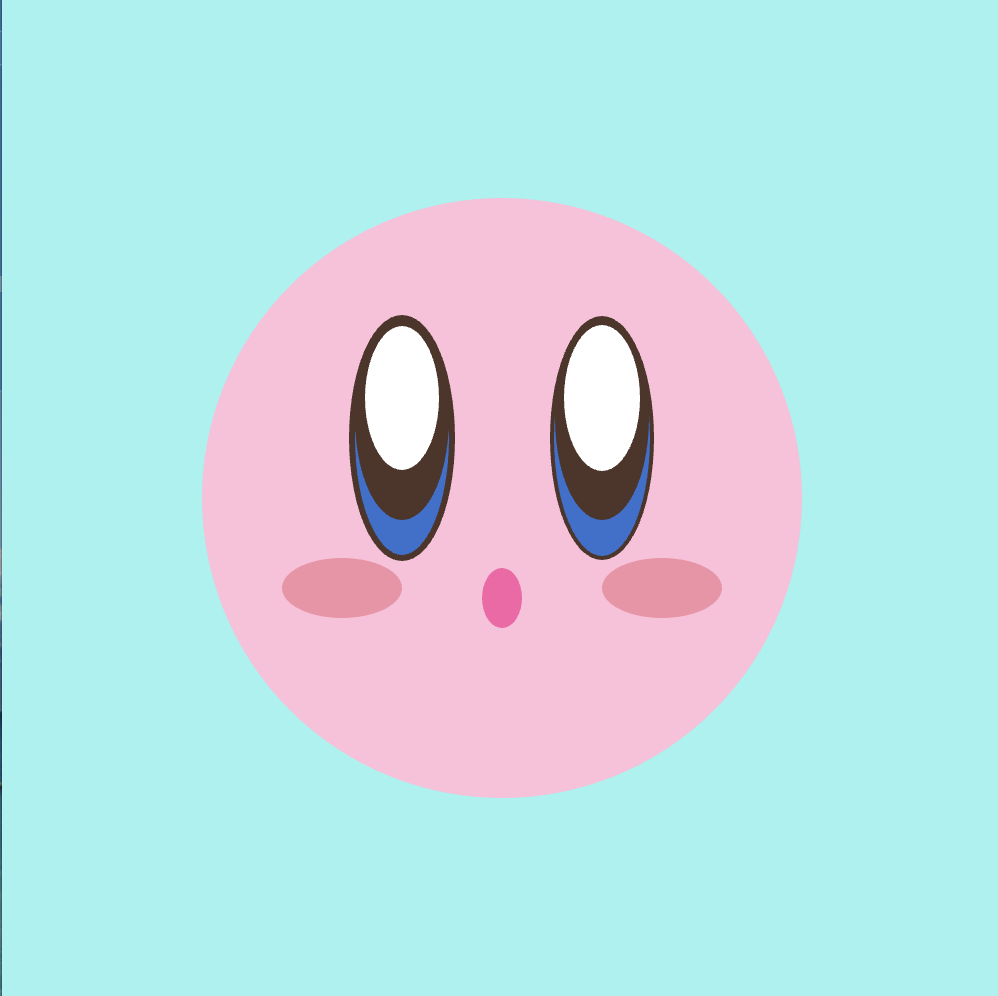
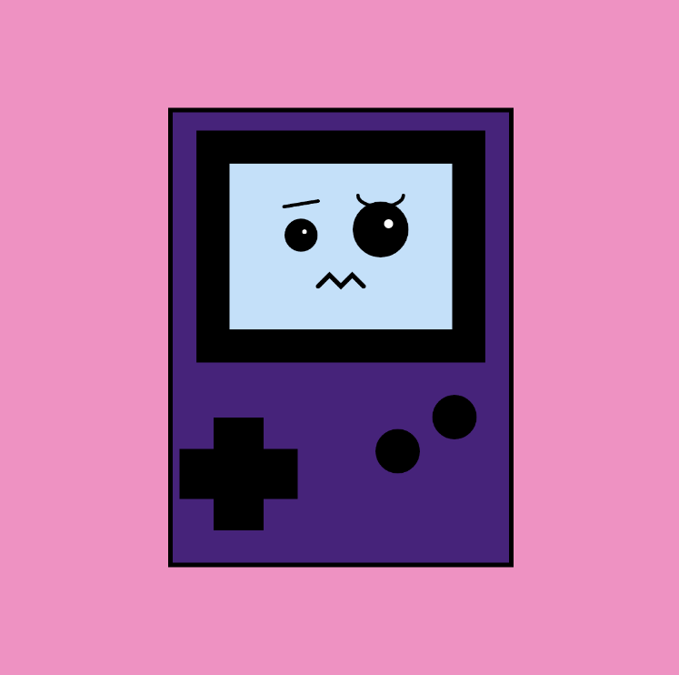
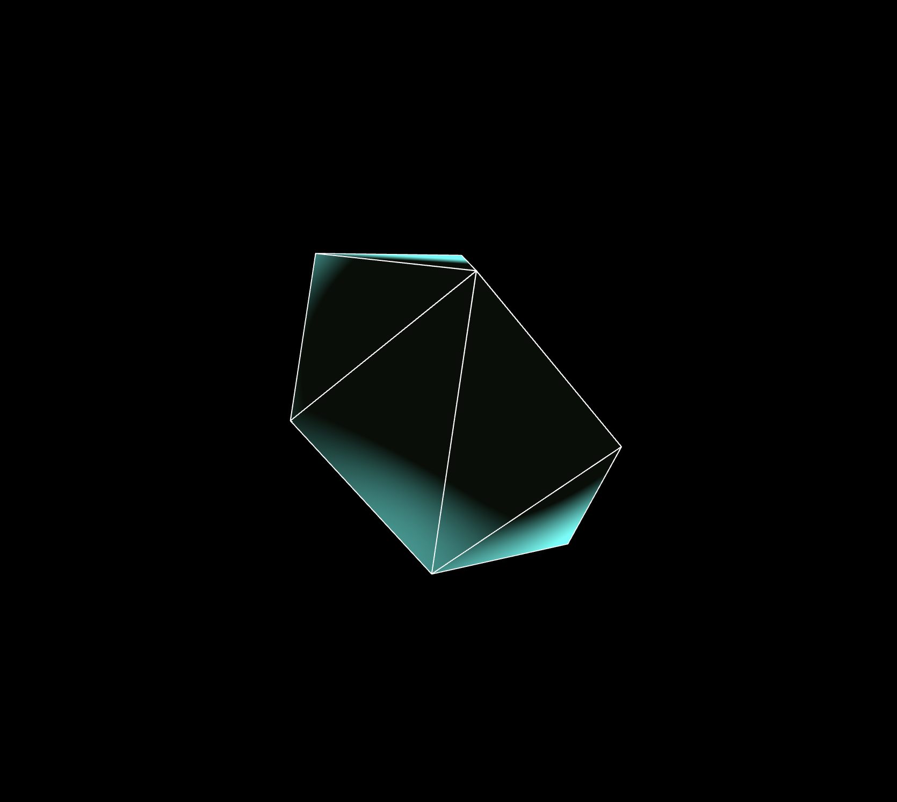
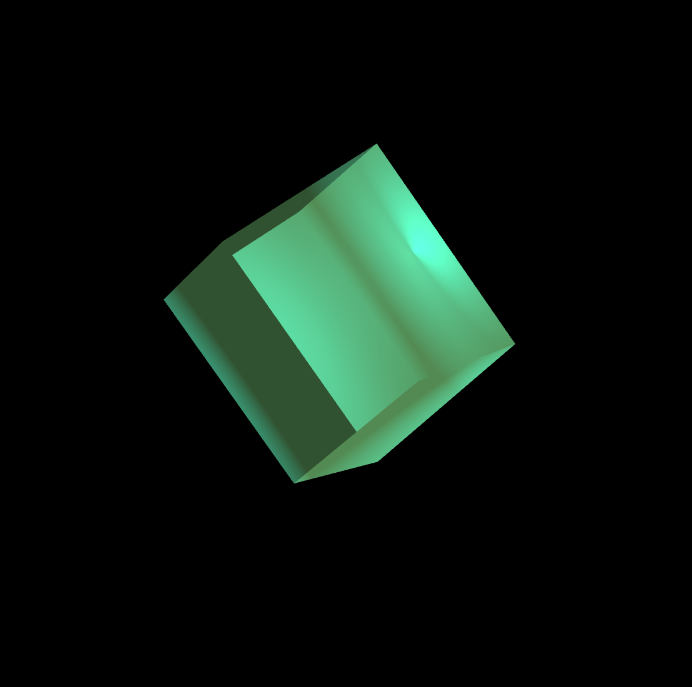
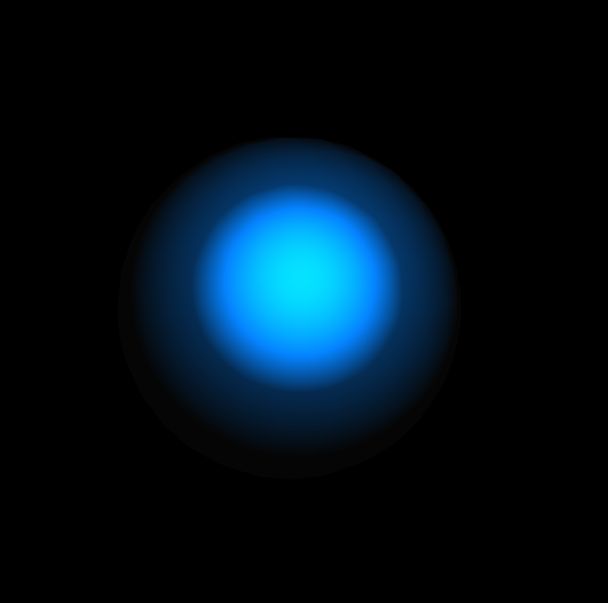
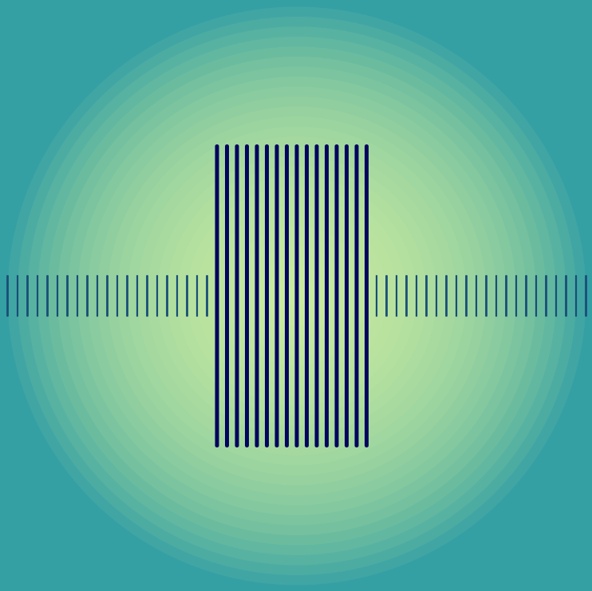
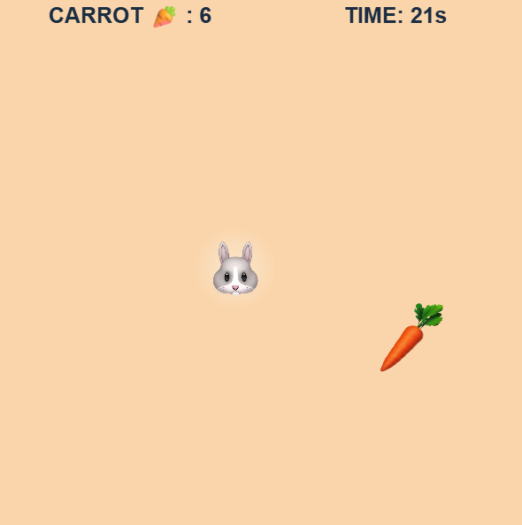

[Home 🏠](README.md) / [Portfolio 💼](https://sabrinarath263.wixsite.com/srathdesigns) / [Reflective Journal 📓](Journal.md) / [Challenges](Challenges.md) / [Prototypes 💻](Prototypes.md)

# Prototypes 💻

> Here you can access and view all my prototypes created during the term.

# <mark> Protoypes: instructions </mark>

# **1.  Click click Poyo!**

SABRINA RATH

[View this project online](https://sabiewasabi.github.io/CART253/prototypes/instructions/instructions-prototype-1/)

[View the code of this project](https://github.com/Sabiewasabi/CART253/blob/main/prototypes/instructions/instructions-prototype-1/js/click-click-poyo.js)

## Description

> *Click click Poyo!* is a interactable experience that allows the user to change the expression of Poyo by clicking it.

> The experience is controlled via the mouse, with left click. Each click will enable Poyo to dsply a different expression.

> The project is meant to give the user a sense of curious and surprise.By clicking on Poyo and having it showcase a new expression, users will then continue to click on Poyo to see hw many different faces it could make.

## Screenshot(s)

## Attribution

> - This project uses [p5.js](https://p5js.org).
> - The image is a capture of *Click click Poyo!* live on p5.js

## License
> This project is licensed under a Creative Commons Attribution ([CC BY 4.0](https://creativecommons.org/licenses/by/4.0/deed.en)) license with the exception of libraries and other components with their own licenses.

# **2. Confusion Gamestation**

SABRINA RATH

[View this project online](https://sabiewasabi.github.io/CART253/prototypes/instructions/instructions-prototype-2/)

[View the code to this project](https://github.com/Sabiewasabi/CART253/blob/main/prototypes/instructions/instructions-prototype-2/js/confusion-gamestation.js)

## Description

> *Confusion Gamastation* is a simulation experience that display an image of a gameboy with a silly face.

> The experience has no controls.

> The project is meant to be a weird gameboy looking back at it's owner confused, is it sentient?.

## Screenshot(s)

## Attribution

> - This project uses [p5.js](https://p5js.org).
> - The image is a capture of *Confusion Gamestation* live on p5.js

## License
> This project is licensed under a Creative Commons Attribution ([CC BY 4.0](https://creativecommons.org/licenses/by/4.0/deed.en)) license with the exception of libraries and other components with their own licenses.

# **3. Geminomonom**

SABRINA RATH

[View this project online](https://sabiewasabi.github.io/CART253/prototypes/instructions/instructions-prototype-3/)

[View the code to this project](https://github.com/Sabiewasabi/CART253/blob/main/prototypes/instructions/instructions-prototype-3/js/geminomonom.js)

## Description

> *Geminomonom* is a astract looping experience of a rotating gem with slightly illuminated edges that will then take on another shape every 5 seconds.

> The experience is controlled via dragging the gem with the cursor unveiling illuminating edges of the gem.

> The project is meant to for users to enjoy an alluring display of light and shadows morphing into different gem shapes which gives it a myserioous look.

> <mark>NOTE:</mark> As for now, the gem does not morph or change colour as I am currently working on how do to so.

## Screenshot(s)

## Attribution

> - This project uses [p5.js](https://p5js.org).
> - The image is a capture of *Emulation Gamestation* live on p5.js

## License
> This project is licensed under a Creative Commons Attribution ([CC BY 4.0](https://creativecommons.org/licenses/by/4.0/deed.en)) license with the exception of libraries and other components with their own licenses.

# <mark> Prototypes: variables </mark>

# **1. Aura Dynamics**

SABRINA RATH

[View this project online](https://sabiewasabi.github.io/CART253/prototypes/variables/variables-prototype-1/)

[View the code to this project](https://github.com/Sabiewasabi/CART253/blob/main/prototypes/variables/variables-prototype-1/js/aura-dynamics.js)

## Description

>This projects features a gradient background and an ellipse placed at the center of the canvas.Each second it changes color at random with a smooth transition using the lerp(); p5.js object.

>This project has no controls but rather it is simply an experience which plays with the endlesss possibility of colors.

## Screenshot(s)

## Attribution

> - This project uses [p5.js](https://p5js.org).
> - The clown image is a capture *Aura Dynamics* live on p5.js

## License

> This project is licensed under a Creative Commons Attribution ([CC BY 4.0](https://creativecommons.org/licenses/by/4.0/deed.en)) license with the exception of libraries and other components with their own licenses.

# 2. **Wavelenghts**

SABRINA RATH

[View this project online](https://sabiewasabi.github.io/CART253/prototypes/variables/variables-prototype-2/)

[View the code to this project](https://github.com/Sabiewasabi/CART253/blob/main/prototypes/variables/variables-prototype-2/js/wavelengths.js)

## Description

> This project is a layered landscape featuring mountains and smooth waves at the foreground using noise and a bright moon looking over the ocean.

> This project was created with intentions of giving the viewers a sense of calm,stillness and serenity while gazing at one of nature's delight - cascading waves with a view.

## Screenshhot(s)

## Attribution

> - This project uses [p5.js](https://p5js.org).
> - The clown image is a capture of *Wavelengths* live on p5.js.

## License

> This project is licensed under a Creative Commons Attribution ([CC BY 4.0](https://creativecommons.org/licenses/by/4.0/deed.en)) license with the exception of libraries and other components with their own licenses.

# **3. Interstellar Chaos**

SABRINA RATH

[View this project online](https://sabiewasabi.github.io/CART253/prototypes/variables/variables-prototype-3/)

[View the code to this project](https://github.com/Sabiewasabi/CART253/blob/main/prototypes/variables/variables-prototype-3/js/interstellar-chaos.js)

## Description

> This project represents an interactive interstellar space simulation made of spinning shapes.

> This experience is controlled by clicking and holding the mouse to have the shapes spin faster.When you release, the speed of the rotating shapes return to normal.

> This project is inspired by a simple idea - bringing order back to chaos.

## Screenshot(s)

## Attribution

> - This project uses [p5.js](https://p5js.org).
> - The clown image is a capture of *Interstellar Chaos* live on p5.js

## License

> This project is licensed under a Creative Commons Attribution ([CC BY 4.0](https://creativecommons.org/licenses/by/4.0/deed.en)) license with the exception of libraries and other components with their own licenses.

# <mark>Prototype: conditionals </mark>

# **1. Geminomonom 2.0**

SABRINA RATH

[View this project online](https://sabiewasabi.github.io/CART253/prototypes/conditionals/conditionals-prototype-1/)

[View the code to this project](https://github.com/Sabiewasabi/CART253/blob/main/prototypes/conditionals/conditionals-prototype-1/js/geminomonom-2.0.js)

## Description

> *Geminomonom 2.0* is a reworking project on the first itteration *Geminomonom*. It is an astract looping experience of a rotating gem with slightly illuminated edges that will then take on another shape every 5 seconds.

> The experience is controlled via dragging the gem with the cursor unveiling illuminating edges of the gem.

> The project is meant for users to enjoy an alluring display of light and shadows morphing into different gem shapes which gives it a myserioous look.

## Screenshot(s)

## Attribution

> - This project uses [p5.js](https://p5js.org).
> - The image is a capture of *Geminomonom 2.0* live on p5.js

## License
> This project is licensed under a Creative Commons Attribution ([CC BY 4.0](https://creativecommons.org/licenses/by/4.0/deed.en)) license with the exception of libraries and other components with their own licenses.

# **2. Azure Marine Core**

SABRINA RATH

[View this project online](https://sabiewasabi.github.io/CART253/prototypes/conditionals/conditionals-prototype-2/)

[View the code to this project](https://github.com/Sabiewasabi/CART253/blob/main/prototypes/conditionals/conditionals-prototype-2/js/azure-marine-core.js)

## Description

> This interactive 3D project uses an if/else blocks to manage two distinct environmental states. In its default calm state, the sphere drifts slowly with deep blue point-lighting and a glowing textual prompt.

> The experience is controlled by clicking and holding the mouse. Doing so causes the code jitters erratically.

## Screenshot(s)

## Attribution

> - This project uses [p5.js](https://p5js.org).
> - The image is a capture of *Azure Marine Core* live on p5.js

## License
> This project is licensed under a Creative Commons Attribution ([CC BY 4.0](https://creativecommons.org/licenses/by/4.0/deed.en)) license with the exception of libraries and other components with their own licenses.

# **3. Gradient Barcode**

SABRINA RATH

[View this project online](https://sabiewasabi.github.io/CART253/prototypes/conditionals/conditionals-prototype-3/)

[View the code to this project](https://github.com/Sabiewasabi/CART253/blob/main/prototypes/conditionals/conditionals-prototype-3/js/gradient-barcode.js)

## Description

> This project is an interactive barcode drawn on top of a gradient background.

> The experience is controlled by moving your mouse along the short verticalk lines to make them stretch out and get slightly thivker to create a wave.

> This project intends to capture the feeling of scanning a barcode.

## Screenshot(s)

## Attribution

> - This project uses [p5.js](https://p5js.org).
> - The image is a capture of *Gradient Barcode* live on p5.js

## License
> This project is licensed under a Creative Commons Attribution ([CC BY 4.0](https://creativecommons.org/licenses/by/4.0/deed.en)) license with the exception of libraries and other components with their own licenses.

# <mark> Prototypes: events </mark>

# **1.  Mofusand Mayhem**

SABRINA RATH

[View this project online](https://sabiewasabi.github.io/CART253/prototypes/events/events-prototype-1/)

[View the code to this project](https://github.com/Sabiewasabi/CART253/blob/main/prototypes/events/events-prototype-1/js/mofusand-mayhem.js)

## Description

>This project is a simple stamp tool that allows the user to click on the canvas and stamp different images onto it. Each time the user clicks, a sound effect will play and the next image in the array will be stamped onto the canvas at the mouse position. The images will loop back to the first one after the last image is used.

>The experience is controlled via mouse clicks, and the user can create a fun and interactive experience by stamping different images onto the canvas.

## Screenshot(s)

## Attribution

> - This project uses [p5.js](https://p5js.org).
> - The image is a capture of *Aura Dynamics* live on p5.js
> - The meowing sound effect is *Cat Meow 8 FX* by *SOUND GARAGE* from pixabay.com

## License

> This project is licensed under a Creative Commons Attribution ([CC BY 4.0](https://creativecommons.org/licenses/by/4.0/deed.en)) license with the exception of libraries and other components with their own licenses.

# **2. What's your RNG today? Dev struggles edition**

SABRINA RATH

[View this project online](https://sabiewasabi.github.io/CART253/prototypes/events/events-prototype-2/)

[View the code to this project](https://github.com/Sabiewasabi/CART253/blob/main/prototypes/events/events-prototype-2/js/rng.js)

## Description

> This project is a simple interactive experience that allows the user to click on a mystery box to reveal a random prize. The prizes are all related to common struggles that developers face, such as debugging, coding, and staying energized.

> This experience is controlled via mouse clicks, and the user can click on the box to reveal a prize, and then click again to close the box and try again. The prizes are displayed with a hollow gradient glow behind them, and the name of the prize is displayed below the image. The project also includes a sound effect that plays when a prize is revealed.

## Screenshhot(s)

## Attribution

> - This project uses [p5.js](https://p5js.org).
> - The clown image is a capture of *What's your RNG today? Dev struggles edition* live on p5.js.
> - The meowing sound effect is *Achievement Badge Pop Sound #3* by *Vadim_Makes_Sound* from pixabay.com

## License

> This project is licensed under a Creative Commons Attribution ([CC BY 4.0](https://creativecommons.org/licenses/by/4.0/deed.en)) license with the exception of libraries and other components with their own licenses.

# 3. **Bunbun Wants Carrots**

SABRINA RATH

[View this project online](https://sabiewasabi.github.io/CART253/prototypes/events/events-prototype-3/)

[View the code to this project](https://github.com/Sabiewasabi/CART253/blob/main/prototypes/events/events-prototype-3/js/bunbun-wants-carrots.js)

## Description

> This project is a simple interactive game where the player guides a bunny around the screen to catch a bouncing carrot. Each carrot caught adds to the score, and the goal is to eat as many as possible before the 30-second timer runs out.

> This experience is controlled via mouse movement, and the bunny follows the cursor with a soft glow behind it. The carrot bounces off the edges of the canvas, and catching it sets off a shockwave ripple where it was eaten, then sends it to a new random spot. The timer turns red in the final 10 seconds, and when time's up, the game displays the total number of carrots eaten. The project also includes a crunch sound effect that plays whenever a carrot is caught.

## Screenshot(s)

## Attribution

> - This project uses [p5.js](https://p5js.org).
> - The image is a capture of *Bunbun Wants Carrots* live on p5.js
> - All images are from google images using the creative doamin search tool
> - The crunch sound effect is *Bone Crack 3* by *Universfield* from pixabay.com

## License

> This project is licensed under a Creative Commons Attribution ([CC BY 4.0](https://creativecommons.org/licenses/by/4.0/deed.en)) license with the exception of libraries and other components with their own licenses.