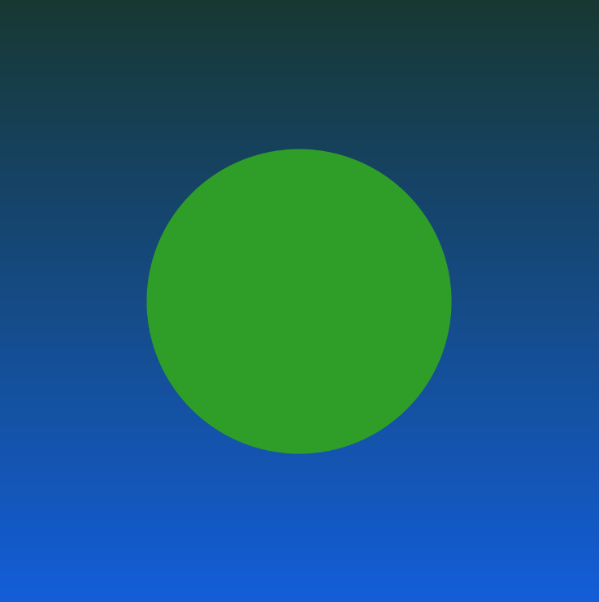
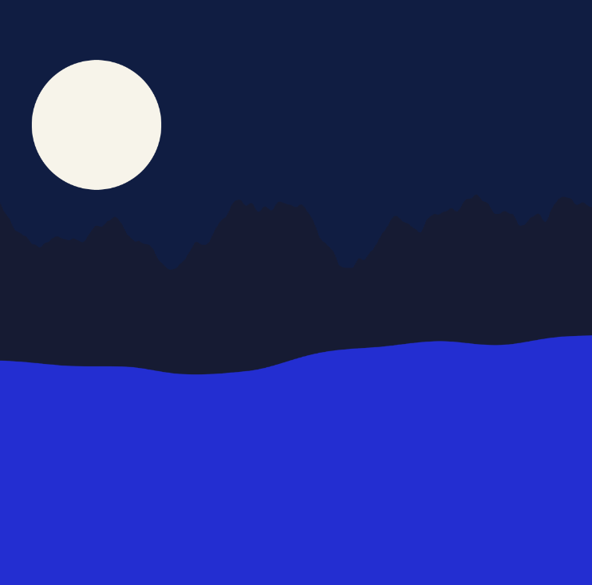

[Home 🏠](README.md) / [Portfolio 💼](https://sabrinarath263.wixsite.com/srathdesigns) /  [Challenges](Challenges.md) / [Prototypes 💻](Prototypes.md)

# <mark> Prototypes: variables </mark>
## [Reflective Journal](Journal.md)

# **1. Aura Dynamics**

SABRINA RATH

[View this project online](https://sabiewasabi.github.io/CART253/prototypes/variables/variables-prototype-1/)

[View the code to this project](https://github.com/Sabiewasabi/CART253/blob/main/prototypes/variables/variables-prototype-1/js/aura-dynamics.js)

## Description

>This projects features a gradient background and an ellipse placed at the center of the canvas.Each second it changes color at random with a smooth transition using the lerp(); p5.js object.

>This project has no controls but rather it is simply an experience which plays with the endlesss possibility of colors.

## Screenshot(s)

## Attribution

> - This project uses [p5.js](https://p5js.org).
> - The clown image is a capture *Aura Dynamics* live on p5.js

## License

> This project is licensed under a Creative Commons Attribution ([CC BY 4.0](https://creativecommons.org/licenses/by/4.0/deed.en)) license with the exception of libraries and other components with their own licenses.

# 2. **Wavelenghts**

SABRINA RATH

[View this project online](https://sabiewasabi.github.io/CART253/prototypes/variables/variables-prototype-2/)

[View the code to this project](https://github.com/Sabiewasabi/CART253/blob/main/prototypes/variables/variables-prototype-2/js/wavelengths.js)

## Description

> This project is a layered landscape featuring mountains and smooth waves at the foreground using noise and a bright moon looking over the ocean.

> This project was created with intentions of giving the viewers a sense of calm,stillness and serenity while gazing at one of nature's delight - cascading waves with a view.

## Screenshhot(s)

## Attribution

> - This project uses [p5.js](https://p5js.org).
> - The clown image is a capture of *Wavelengths* live on p5.js.

## License

> This project is licensed under a Creative Commons Attribution ([CC BY 4.0](https://creativecommons.org/licenses/by/4.0/deed.en)) license with the exception of libraries and other components with their own licenses.

# **3. Interstellar Chaos**

SABRINA RATH

[View this project online](https://sabiewasabi.github.io/CART253/prototypes/variables/variables-prototype-3/)

[View the code to this project](https://github.com/Sabiewasabi/CART253/blob/main/prototypes/variables/variables-prototype-3/js/interstellar-chaos.js)

## Description

> This project represents an interactive interstellar space simulation made of spinning shapes.

> This experience is controlled by clicking and holding the mouse to have the shapes spin faster.When you release, the speed of the rotating shapes return to normal.

> This project is inspired by a simple idea - bringing order back to chaos.

## Screenshot(s)

## Attribution

> - This project uses [p5.js](https://p5js.org).
> - The clown image is a capture of *Interstellar Chaos* live on p5.js

## License

> This project is licensed under a Creative Commons Attribution ([CC BY 4.0](https://creativecommons.org/licenses/by/4.0/deed.en)) license with the exception of libraries and other components with their own licenses.
