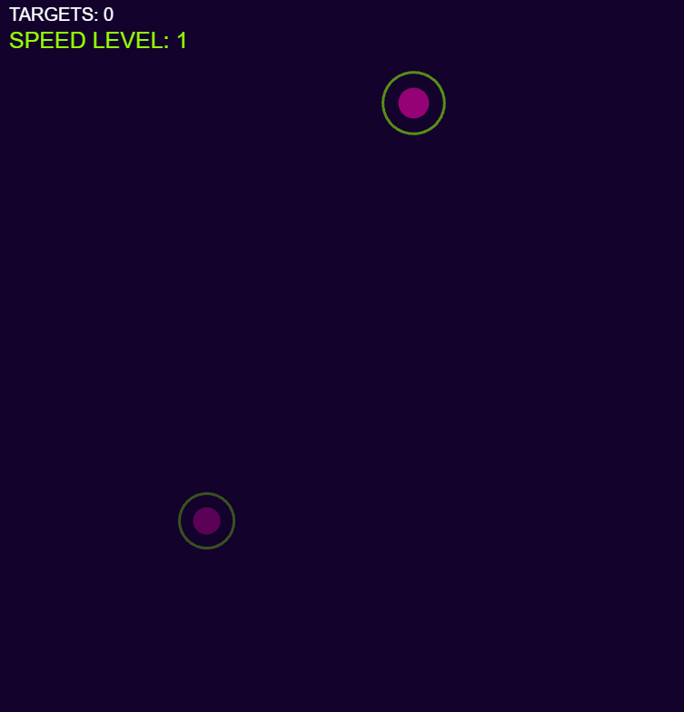

# Neon Glitch

SABRINA RATH

[View this project online](https://sabiewasabi.github.io/CART253/prototypes/arrays/arrays-prototype-3/)

[View the code to this project](https://github.com/Sabiewasabi/CART253/blob/main/prototypes/arrays/arrays-prototype-3/js/neon-glitch.js)

## Description

> This project is a dynamic, neon-themed reaction-popping game.

> This experience is controlled via mouse clicks on the target to earn points. Each 10 points the speed level increases.

## Screenshot(s)

## Attribution

> - This project uses [p5.js](https://p5js.org).
> - The image is a capture of *Neon Glitch* live on p5.js

## License

> This project is licensed under a Creative Commons Attribution ([CC BY 4.0](https://creativecommons.org/licenses/by/4.0/deed.en)) license with the exception of libraries and other components with their own licenses.