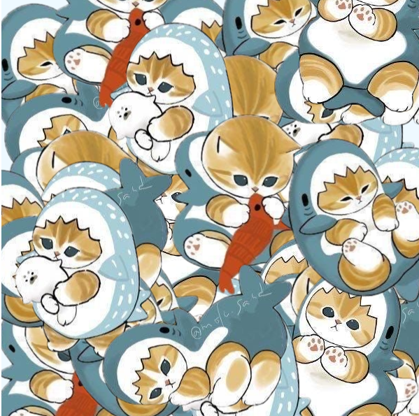

# Mofusand Mayhem

SABRINA RATH

[View this project online](https://sabiewasabi.github.io/CART253/prototypes/events/events-prototype-1/)

[View the code to this project](https://github.com/Sabiewasabi/CART253/blob/main/prototypes/events/events-prototype-1/js/mofusand-mayhem.js)

## Description

>This project is a simple stamp tool that allows the user to click on the canvas and stamp different images onto it. Each time the user clicks, a sound effect will play and the next image in the array will be stamped onto the canvas at the mouse position. The images will loop back to the first one after the last image is used.

>The experience is controlled via mouse clicks, and the user can create a fun and interactive experience by stamping different images onto the canvas.

## Screenshot(s)

## Attribution

> - This project uses [p5.js](https://p5js.org).
> - The image is a capture of *Aura Dynamics* live on p5.js
> - The meowing sound effect is *Cat Meow 8 FX* by *SOUND GARAGE* from pixabay.com

## License

> This project is licensed under a Creative Commons Attribution ([CC BY 4.0](https://creativecommons.org/licenses/by/4.0/deed.en)) license with the exception of libraries and other components with their own licenses.