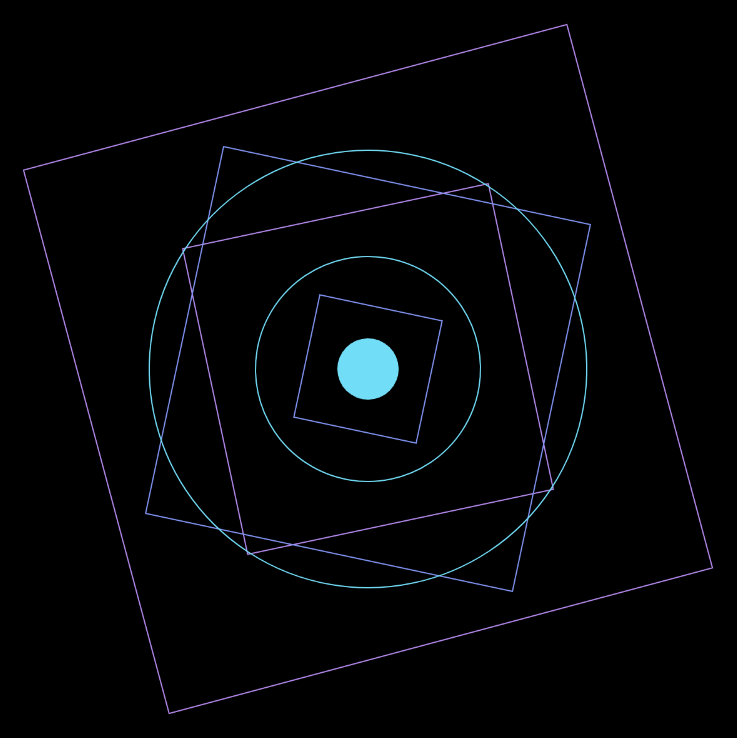

# Interstellar Chaos

SABRINA RATH

[View this project online](https://sabiewasabi.github.io/CART253/prototypes/variables/variables-prototype-3/)

[View the code to this project](https://github.com/Sabiewasabi/CART253/blob/main/prototypes/variables/variables-prototype-3/js/interstellar-chaos.js)

## Description

> This project is a simple interactive game where the player guides a bunny around the screen to catch a bouncing carrot. Each carrot caught adds to the score, and the goal is to eat as many as possible before the 30-second timer runs out.

> This experience is controlled via mouse movement, and the bunny follows the cursor with a soft glow behind it. The carrot bounces off the edges of the canvas, and catching it sets off a shockwave ripple where it was eaten, then sends it to a new random spot. The timer turns red in the final 10 seconds, and when time's up, the game displays the total number of carrots eaten. The project also includes a crunch sound effect that plays whenever a carrot is caught.

## Screenshot(s)

## Attribution

> - This project uses [p5.js](https://p5js.org).
> - The image is a capture of *Bunbun Wants Carrots* live on p5.js
> - All images are from google images using the creative doamin search tool

## License

> This project is licensed under a Creative Commons Attribution ([CC BY 4.0](https://creativecommons.org/licenses/by/4.0/deed.en)) license with the exception of libraries and other components with their own licenses.