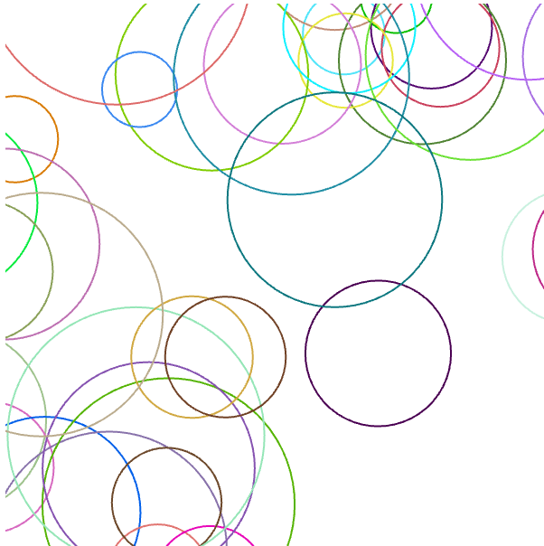

# Swift Ripples

SABRINA RATH

[View this project online](https://sabiewasabi.github.io/CART253/prototypes/functions/functions-prototype-1/)

[View the code to this project](https://github.com/Sabiewasabi/CART253/blob/main/prototypes/functions/functions-prototype-1/js/swift-ripples.js)

## Description

> This project is an interactive experience where moving your mouse generates colorful, expanding rain ripples across the canvas.

> The experience has no click controls; it is controlled entirely via mouse hovering,

## Screenshot(s)

## Attribution

> - This project uses [p5.js](https://p5js.org).
> - The image is a capture of *Swift Ripples* live on p5.js

## License

> This project is licensed under a Creative Commons Attribution ([CC BY 4.0](https://creativecommons.org/licenses/by/4.0/deed.en)) license with the exception of libraries and other components with their own licenses.