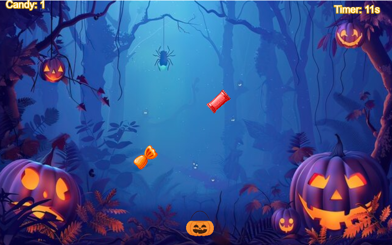

# Candy Galore
SABRINA RATH

[View this project online](https://sabiewasabi.github.io/CART253/prototypes/functions/functions-prototype-2/)

[View the code to this project](https://github.com/Sabiewasabi/CART253/blob/main/prototypes/functions/functions-prototype-2/js/rng.js)

## Description

> This project is an interactive Halloween themed catching game where the user moves a trick-or-treat bucket to catch 8 different types of falling candy images

> This experience is controlled via the left and right arrow keys to move the trick-or-treat bucket to collect as many candies as you can before the timre runs out.

## Screenshhot(s)

## Attribution

> - This project uses [p5.js](https://p5js.org).
> - The image is a capture of *Candy Galore* live on p5.js.
> - The collect sound effect is *3 down fast 3* by *3 down fast 3
Leszek_Szary (Freesound)* from pixabay.com
> - All images are from google images using the creative domain search tool

## License

> This project is licensed under a Creative Commons Attribution ([CC BY 4.0](https://creativecommons.org/licenses/by/4.0/deed.en)) license with the exception of libraries and other components with their own licenses.