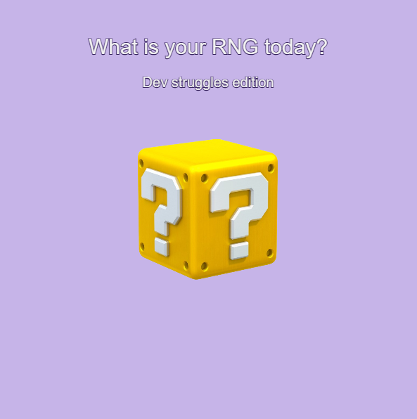

# What's Your RNG Today? Dev Struggles Edition

SABRINA RATH

[View this project online](https://sabiewasabi.github.io/CART253/prototypes/events/events-prototype-2/)

[View the code to this project](https://github.com/Sabiewasabi/CART253/blob/main/prototypes/events/events-prototype-2/js/rng.js)

## Description

## Screenshhot(s)

## Attribution

> - This project uses [p5.js](https://p5js.org).
> - The image is a capture of *What's Your RNG Today? Dev Struggles Edition* live on p5.js.
> - The meowing sound effect is *Achievement Badge Pop Sound #3* by *Vadim_Makes_Sound* from pixabay.com

## License

> This project is licensed under a Creative Commons Attribution ([CC BY 4.0](https://creativecommons.org/licenses/by/4.0/deed.en)) license with the exception of libraries and other components with their own licenses.