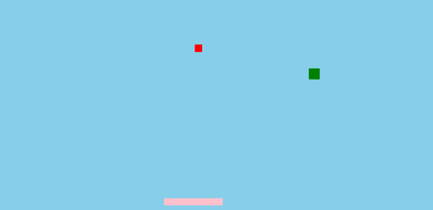

# Paddle Buddy

SABRINA RATH AND ERICA GAVEZ

[View this project online](https://sabiewasabi.github.io/CART253/topics/functions-challenge/)

[View the code online](https://github.com/Sabiewasabi/CART253/blob/main/topics/functions-challenge/js/paddle-buddy.js)

## Description

> This project contains two balls that bounce at different velocities that bounces on a paddle that the user controls

> The experience is controlled via both left and right arrow keys that move the paddle in which both of the balls collides with it that makes it bounce.

## Screenshot(s)

## Attribution

> - This project uses [p5.js](https://p5js.org).
> - The image is a capture of the *Paddle Buddy* live on p5.js.

## License

> This project is licensed under a Creative Commons Attribution ([CC BY 4.0](https://creativecommons.org/licenses/by/4.0/deed.en)) license with the exception of libraries and other components with their own licenses.