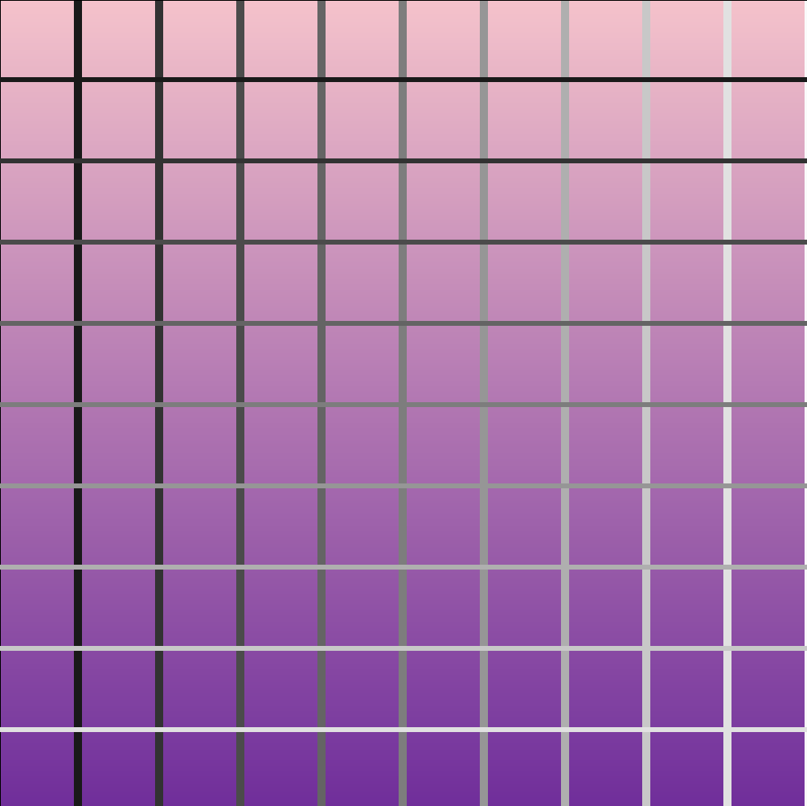

# Lines

SABRINA RATH AND ERICA GAVEZ

[View this project online](https://sabiewasabi.github.io/CART253/topics/loop-challenge/)

[View the code of this project online](https://github.com/Sabiewasabi/CART253/blob/main/topics/loop-challenge/js/lines.js)

## Description

> This project is a series of lines drawn across a gradient canvas.

> This experience has no controls.

## Screenshot(s)

## Attribution

> - This project uses [p5.js](https://p5js.org).
> - The image is a capture of *Lines* live on p5.js

## License

> This project is licensed under a Creative Commons Attribution ([CC BY 4.0](https://creativecommons.org/licenses/by/4.0/deed.en)) license with the exception of libraries and other components with their own licenses.